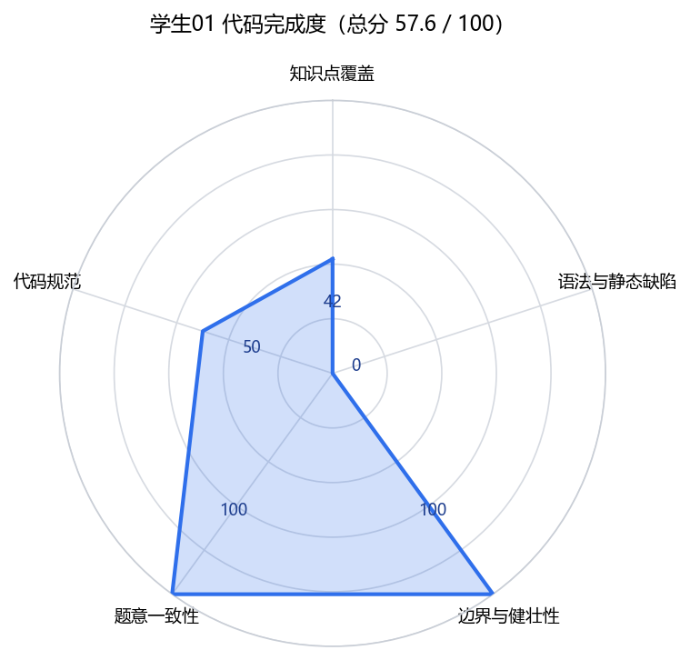
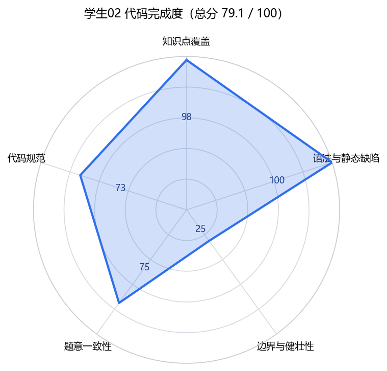
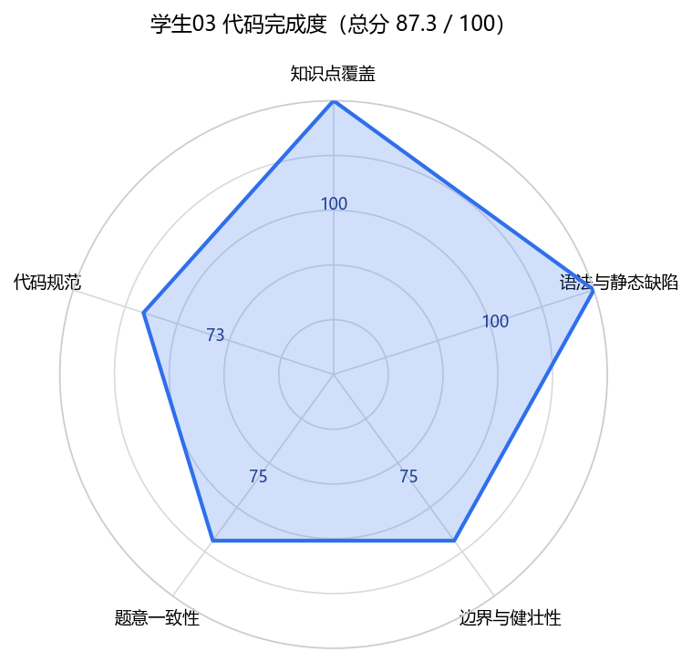
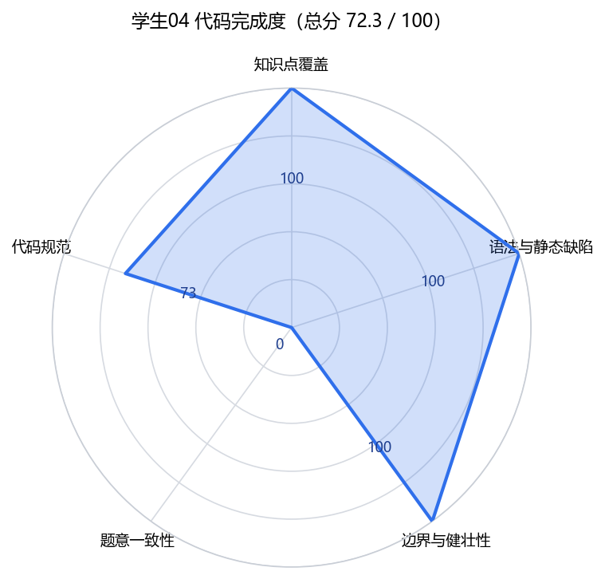
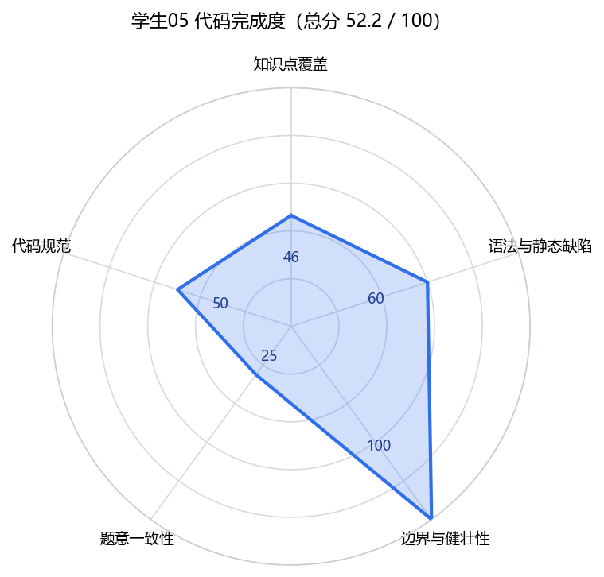

# 03-列表 学生代码质量评测报告

- 生成时间：2026-10-24 11:13
- 课程 / 题量：03-列表 / 15 题
- 学生样本：5 人（03-列表）
- 作业编号沿用题库函数名（func301 表示第 3 章第 1 题）
- 分析链路：pylint 静态检查 + AST 知识点检测 + 题库语义规则 + 评分量表加权

## 一、评测口径

| 维度 | 权重 | 判定方式 |
| --- | --- | --- |
| 知识点覆盖 | 30% | 题目要求的知识点命中率（AST 检测）；文件整体无法解析时按 50% 计 |
| 语法与静态缺陷 | 20% | 语法错误与 lint error 逐条扣分（每条 40 分） |
| 边界与健壮性 | 15% | 越界、上界等边界缺陷扣分（每条 25 分） |
| 题意一致性 | 25% | 与题意冲突的写法（返回码、方向、类型）扣分（每条 25 分） |
| 代码规范 | 10% | pylint 规范提示扣分（命名问题按一类计） |

**量表来源**：03评分量表.md 为空（0 字节），使用内置默认量表。

**边界说明**：本次为静态评测，学生代码没有被执行（本机 Docker Linux 引擎不可用，按项目约定不在主机直接运行学生代码），因此缺陷是静态推断，“疑似”项需要教师用样例数据复核；报告不把静态推断写成运行通过或运行失败。

## 二、总览

| 学生 | 总分 | 等级 | 知识点覆盖 | 语法与静态缺陷 | 边界与健壮性 | 题意一致性 | 代码规范 | 缺陷条数 |
| --- | --- | --- | --- | --- | --- | --- | --- | --- |
| 学生01 | 57.6 | E | 42 | 0 | 100 | 100 | 50 | 3 |
| 学生02 | 79.1 | C | 98 | 100 | 25 | 75 | 73 | 4 |
| 学生03 | 87.3 | B | 100 | 100 | 75 | 75 | 73 | 2 |
| 学生04 | 72.3 | C | 100 | 100 | 100 | 0 | 73 | 5 |
| 学生05 | 52.2 | E | 46 | 60 | 100 | 25 | 50 | 4 |

## 三、分学生报告

### 学生01 · 总分 57.6 / 100（E）

| 作业编号 | 该题目需要用到的python基础知识点 | 缺陷及所在代码行 | 修改建议 |
| --- | --- | --- | --- |
| `func301` | 列表合并（+ / extend）；切片与 1 起始计数换算（语法未通过，未能验证） | 第 6 行：语法错误：缺少冒号 | 先修正该函数的语法，使其可以独立解析，再检查逻辑 |
| `func302` | len() 求长度 ✓；下标算术（// 取中间位置） ✓；if / else 分支 ✓；整除 // ✓ | 未发现静态缺陷 | — |
| `func303` | 切片反转 [::-1]；比较运算与 ==；if / else 分支（语法未通过，未能验证） | 第 21 行：语法错误：缺少冒号 | 先修正该函数的语法，使其可以独立解析，再检查逻辑 |
| `func304` | for 遍历 ✓；删除元素或重建列表 ✓ | 未发现静态缺陷 | — |
| `func305` | 列表推导式；type() / isinstance 类型判断（语法未通过，未能验证） | 第 34 行：语法错误：语法不合法（常见于 if / def 缺少冒号，或把 == 写成 =） | 先修正该函数的语法，使其可以独立解析，再检查逻辑 |
| `func306` | 自定义辅助函数 ✓；双重循环 ✓；计数器累加 ✓ | 未发现静态缺陷 | — |
| `func307` | while 循环 ✓；负索引 ✓；列表增删（insert / del / append） ✓ | 未发现静态缺陷 | — |
| `func308` | for 遍历 ✓；计数器累加 ✓；if / elif / else 多分支 ✓ | 未发现静态缺陷 | — |
| `func309` | 二维列表 ✓；sort(key=...) 自定义排序 ✓；lambda 表达式 ✓ | 未发现静态缺陷 | — |
| `func310` | range() 区间 ✓；列表推导式 ✓；自定义辅助函数 ✓ | 未发现静态缺陷 | — |
| `func311` | str() / int() 数位拆分 ✓；列表拼接构建 ✓；reverse() / reversed() 反转 ✓ | 未发现静态缺陷 | — |
| `func312` | while 循环 ✓；max() / min() 内置聚合 ✓；列表拼接构建 ✓ | 未发现静态缺陷 | — |
| `func313` | 二维列表 ✓；二维遍历 ✓；按行 append 子列表 ✓ | 未发现静态缺陷 | — |
| `func314` | sort(key=...) 自定义排序 ✓；lambda 表达式 ✓；自定义辅助函数 ✓ | 未发现静态缺陷 | — |
| `func315` | 线性扫描定位 ✓；insert() 插入 ✓；比较运算与 == ✓ | 未发现静态缺陷 | — |

> 文件整体解析失败：第 6 行：缺少冒号；pylint 已跳过，缺陷来自逐函数语法检查。

### 学生02 · 总分 79.1 / 100（C）

| 作业编号 | 该题目需要用到的python基础知识点 | 缺陷及所在代码行 | 修改建议 |
| --- | --- | --- | --- |
| `func301` | 列表合并（+ / extend） ✓；切片与 1 起始计数换算 ✓ | 未发现静态缺陷 | — |
| `func302` | len() 求长度 ✓；下标算术（// 取中间位置） ✓；if / else 分支 ✓；整除 // ✓ | 第 16 行：偶数长度时中间右下标为 len//2，再 +1 等于 len，访问会越界 第 19 行：偶数长度时中间右下标为 len//2，再 +1 等于 len，访问会越界 | 偶数个元素时两个中间下标分别是 len//2-1 与 len//2，不要越过 len-1 |
| `func303` | 切片反转 [::-1] ✓；比较运算与 == ✓；if / else 分支 ✓ | 未发现静态缺陷 | — |
| `func304` | for 遍历 ✓；删除元素或重建列表 ✓ | 未发现静态缺陷 | — |
| `func305` | 列表推导式 ✓；type() / isinstance 类型判断 ✓ | 未发现静态缺陷 | — |
| `func306` | 自定义辅助函数 ✓；双重循环 ✓；计数器累加 ✓ | 未发现静态缺陷 | — |
| `func307` | while 循环 ✓；负索引 ✓；列表增删（insert / del / append） ✓ | 未发现静态缺陷 | — |
| `func308` | for 遍历 ✓；计数器累加 ✓；if / elif / else 多分支 ✓ | 未发现静态缺陷 | — |
| `func309` | 二维列表 ✓；sort(key=...) 自定义排序 ✓；lambda 表达式 ✓ | 未发现静态缺陷 | — |
| `func310` | range() 区间 ✓；列表推导式 ✓；自定义辅助函数 ✓ | 未发现静态缺陷 | — |
| `func311` | str() / int() 数位拆分 ✓；列表拼接构建 ✓；reverse() / reversed() 反转 ✓ | 第 120 行：直接遍历列表元素（整数）会抛 TypeError：整数不可迭代 | 先把当前元素转成字符串，再逐字符取数字 |
| `func312` | while 循环 ✓；max() / min() 内置聚合 ✓；列表拼接构建 ✓ | 未发现静态缺陷 | — |
| `func313` | 二维列表 ✓；二维遍历 ✓；按行 append 子列表 ✗ | 第 139 行：转置需要把每一列作为子列表 append 进结果，extend 会把列展开成一维列表 | 把整列作为一个元素追加到结果列表，而不是展开追加 |
| `func314` | sort(key=...) 自定义排序 ✓；lambda 表达式 ✓；自定义辅助函数 ✓ | 未发现静态缺陷 | — |
| `func315` | 线性扫描定位 ✓；insert() 插入 ✓；比较运算与 == ✓ | 未发现静态缺陷 | — |

**pylint 规范提示（不计入缺陷列，影响“代码规范”维度）**

- 命名不规范共 24 处（第 7、8、11、21、27、34 行等），单字母变量名会降低可读性
- 第 35 行：用 type() 比较类型（建议 isinstance，但本题允许 type）
- 第 63 行：变量名覆盖了内置函数
- 第 154 行：遍历索引可用 enumerate 简化

### 学生03 · 总分 87.3 / 100（B）

| 作业编号 | 该题目需要用到的python基础知识点 | 缺陷及所在代码行 | 修改建议 |
| --- | --- | --- | --- |
| `func301` | 列表合并（+ / extend） ✓；切片与 1 起始计数换算 ✓ | 第 9 行：切片边界 [7:16] 与“第 8~15 个元素”不一致：题目从 1 开始计数，换算成 0 起始下标应为 [7:15] | 按“起始下标 = 序号 - 1、切片右端不包含”重新计算两个边界，再用题目给的样例输入核对结果长度 |
| `func302` | len() 求长度 ✓；下标算术（// 取中间位置） ✓；if / else 分支 ✓；整除 // ✓ | 未发现静态缺陷 | — |
| `func303` | 切片反转 [::-1] ✓；比较运算与 == ✓；if / else 分支 ✓ | 未发现静态缺陷 | — |
| `func304` | for 遍历 ✓；删除元素或重建列表 ✓ | 未发现静态缺陷 | — |
| `func305` | 列表推导式 ✓；type() / isinstance 类型判断 ✓ | 未发现静态缺陷 | — |
| `func306` | 自定义辅助函数 ✓；双重循环 ✓；计数器累加 ✓ | 未发现静态缺陷 | — |
| `func307` | while 循环 ✓；负索引 ✓；列表增删（insert / del / append） ✓ | 未发现静态缺陷 | — |
| `func308` | for 遍历 ✓；计数器累加 ✓；if / elif / else 多分支 ✓ | 未发现静态缺陷 | — |
| `func309` | 二维列表 ✓；sort(key=...) 自定义排序 ✓；lambda 表达式 ✓ | 未发现静态缺陷 | — |
| `func310` | range() 区间 ✓；列表推导式 ✓；自定义辅助函数 ✓ | 第 115 行：range(2, N) 的上界不包含 N，题目要求 N 以内包含 N | 把 range 的上界写成 N+1，保证 N 本身参与判断 |
| `func311` | str() / int() 数位拆分 ✓；列表拼接构建 ✓；reverse() / reversed() 反转 ✓ | 未发现静态缺陷 | — |
| `func312` | while 循环 ✓；max() / min() 内置聚合 ✓；列表拼接构建 ✓ | 未发现静态缺陷 | — |
| `func313` | 二维列表 ✓；二维遍历 ✓；按行 append 子列表 ✓ | 未发现静态缺陷 | — |
| `func314` | sort(key=...) 自定义排序 ✓；lambda 表达式 ✓；自定义辅助函数 ✓ | 未发现静态缺陷 | — |
| `func315` | 线性扫描定位 ✓；insert() 插入 ✓；比较运算与 == ✓ | 未发现静态缺陷 | — |

**pylint 规范提示（不计入缺陷列，影响“代码规范”维度）**

- 命名不规范共 24 处（第 7、8、11、21、27、34 行等），单字母变量名会降低可读性
- 第 35 行：用 type() 比较类型（建议 isinstance，但本题允许 type）
- 第 63 行：变量名覆盖了内置函数
- 第 154 行：遍历索引可用 enumerate 简化

### 学生04 · 总分 72.3 / 100（C）

| 作业编号 | 该题目需要用到的python基础知识点 | 缺陷及所在代码行 | 修改建议 |
| --- | --- | --- | --- |
| `func301` | 列表合并（+ / extend） ✓；切片与 1 起始计数换算 ✓ | 未发现静态缺陷 | — |
| `func302` | len() 求长度 ✓；下标算术（// 取中间位置） ✓；if / else 分支 ✓；整除 // ✓ | 第 16 行：偶数个元素时应取中间两数中较小的一个，该分支返回的却是较大者 | 把比较方向反过来，或在两个中间元素之间用 min 取较小值 |
| `func303` | 切片反转 [::-1] ✓；比较运算与 == ✓；if / else 分支 ✓ | 未发现静态缺陷 | — |
| `func304` | for 遍历 ✓；删除元素或重建列表 ✓ | 未发现静态缺陷 | — |
| `func305` | 列表推导式 ✓；type() / isinstance 类型判断 ✓ | 第 35 行：题目要求删除“不是整数”的元素，这里判断的是 str，筛选条件与题意相反 | 把类型判断改为 int（或 isinstance(..., int)），让它筛选出整数 |
| `func306` | 自定义辅助函数 ✓；双重循环 ✓；计数器累加 ✓ | 未发现静态缺陷 | — |
| `func307` | while 循环 ✓；负索引 ✓；列表增删（insert / del / append） ✓ | 未发现静态缺陷 | — |
| `func308` | for 遍历 ✓；计数器累加 ✓；if / elif / else 多分支 ✓ | 第 104 行：偶数个数大于奇数个数应返回 2，当前返回 3 | 按题目给定的返回码对照表重排三个分支的返回值 |
| `func309` | 二维列表 ✓；sort(key=...) 自定义排序 ✓；lambda 表达式 ✓ | 第 109 行：总分相同时要求按学号升序，但 reverse=True 会让第二个排序键整体降序，疑似排序键方向不对 | 对第二个排序键（学号）取负，或改用两次稳定排序 |
| `func310` | range() 区间 ✓；列表推导式 ✓；自定义辅助函数 ✓ | 未发现静态缺陷 | — |
| `func311` | str() / int() 数位拆分 ✓；列表拼接构建 ✓；reverse() / reversed() 反转 ✓ | 未发现静态缺陷 | — |
| `func312` | while 循环 ✓；max() / min() 内置聚合 ✓；列表拼接构建 ✓ | 未发现静态缺陷 | — |
| `func313` | 二维列表 ✓；二维遍历 ✓；按行 append 子列表 ✓ | 未发现静态缺陷 | — |
| `func314` | sort(key=...) 自定义排序 ✓；lambda 表达式 ✓；自定义辅助函数 ✓ | 未发现静态缺陷 | — |
| `func315` | 线性扫描定位 ✓；insert() 插入 ✓；比较运算与 == ✓ | 第 155 行：升序列表应在 Num < A[i] 时插入，当前用 Num > A[i]，插入位置方向相反 | 把比较方向改为待插入值小于当前元素时插入 |

**pylint 规范提示（不计入缺陷列，影响“代码规范”维度）**

- 命名不规范共 24 处（第 7、8、11、21、27、34 行等），单字母变量名会降低可读性
- 第 35 行：用 type() 比较类型（建议 isinstance，但本题允许 type）
- 第 63 行：变量名覆盖了内置函数
- 第 154 行：遍历索引可用 enumerate 简化

### 学生05 · 总分 52.2 / 100（E）

| 作业编号 | 该题目需要用到的python基础知识点 | 缺陷及所在代码行 | 修改建议 |
| --- | --- | --- | --- |
| `func301` | 列表合并（+ / extend）；切片与 1 起始计数换算（语法未通过，未能验证） | 第 7 行：语法错误：缺少冒号 | 先修正该函数的语法，使其可以独立解析，再检查逻辑 |
| `func302` | len() 求长度 ✓；下标算术（// 取中间位置） ✓；if / else 分支 ✓；整除 // ✓ | 未发现静态缺陷 | — |
| `func303` | 切片反转 [::-1] ✓；比较运算与 == ✓；if / else 分支 ✓ | 第 23 行：回文判断为真时应返回 1，当前分支返回 0，返回值语义与题目相反 | 交换两个分支的返回常量，保持“是回文→1、不是→0” |
| `func304` | for 遍历 ✓；删除元素或重建列表 ✓ | 未发现静态缺陷 | — |
| `func305` | 列表推导式 ✓；type() / isinstance 类型判断 ✓ | 未发现静态缺陷 | — |
| `func306` | 自定义辅助函数 ✓；双重循环 ✓；计数器累加 ✓ | 未发现静态缺陷 | — |
| `func307` | while 循环 ✓；负索引 ✓；列表增删（insert / del / append） ✓ | 未发现静态缺陷 | — |
| `func308` | for 遍历 ✓；计数器累加 ✓；if / elif / else 多分支 ✓ | 未发现静态缺陷 | — |
| `func309` | 二维列表 ✓；sort(key=...) 自定义排序 ✓；lambda 表达式 ✓ | 未发现静态缺陷 | — |
| `func310` | range() 区间 ✓；列表推导式 ✓；自定义辅助函数 ✓ | 未发现静态缺陷 | — |
| `func311` | str() / int() 数位拆分 ✓；列表拼接构建 ✓；reverse() / reversed() 反转 ✗ | 第 117 行：逐位拆分后没有反转，拼接结果是高位到低位，题目要求从低位到高位 | 对每位数字组成的子列表做一次反转，再拼进结果 |
| `func312` | while 循环 ✓；max() / min() 内置聚合 ✓；列表拼接构建 ✓ | 第 131 行：两数平均应使用整除 //，/ 会得到浮点数，后续结果类型与题目要求不符 | 把 / 改成 //，保持列表元素仍是整数 |
| `func313` | 二维列表 ✓；二维遍历 ✓；按行 append 子列表 ✓ | 未发现静态缺陷 | — |
| `func314` | sort(key=...) 自定义排序 ✓；lambda 表达式 ✓；自定义辅助函数 ✓ | 未发现静态缺陷 | — |
| `func315` | 线性扫描定位 ✓；insert() 插入 ✓；比较运算与 == ✓ | 未发现静态缺陷 | — |

> 文件整体解析失败：第 7 行：缺少冒号；pylint 已跳过，缺陷来自逐函数语法检查。

## 四、共性缺陷与教学建议

| 出现次数 | 缺陷类型 |
| --- | --- |
| 4 | 语法错误 |
| 2 | 偶数长度时中间右下标为 len//2，再 +1 等于 len，访问会越界 |
| 1 | 直接遍历列表元素（整数）会抛 TypeError |
| 1 | 转置需要把每一列作为子列表 append 进结果，extend 会把列展开成一维列表 |
| 1 | 切片边界 [7:16] 与“第 8~15 个元素”不一致 |
| 1 | range(2, N) 的上界不包含 N，题目要求 N 以内包含 N |
| 1 | 偶数个元素时应取中间两数中较小的一个，该分支返回的却是较大者 |
| 1 | 题目要求删除“不是整数”的元素，这里判断的是 str，筛选条件与题意相反 |

**建议**

- 先做语法专项：函数定义与 if 语句的冒号、`=` 与 `==` 的区别、缩进一致性。
- 用空列表、单元素、偶数长度、上界元素四类数据练习边界推演，特别是 range 右端不包含。
- 要求学生先用题目给的样例手工走一遍分支和返回值，再写代码，减少“能跑但意思反了”的错误。
